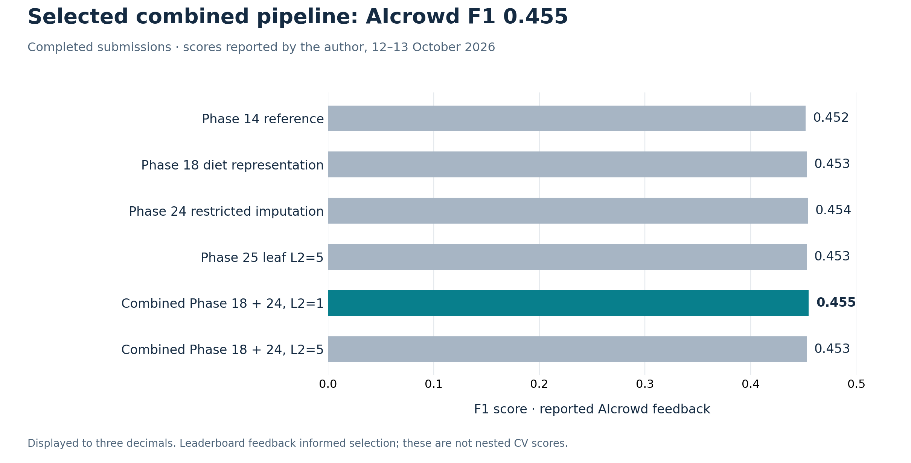
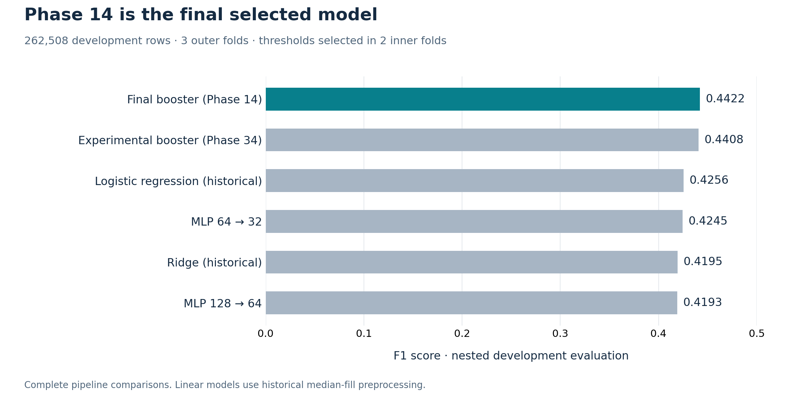

# Results and interpretation

The completed **14 October 2026 release** selects **Combined Phase 18 + Phase 24, leaf L2 = 1** (`combined18_24_l2_1`). Author-reported AIcrowd feedback is **F1 0.455 and accuracy 0.882**, the highest displayed F1 among completed candidates with recorded feedback. The author reports **3rd place on 14 October 2026** on the [AIcrowd leaderboard](https://www.aicrowd.com/challenges/epfl-machine-learning-project-1/leaderboards). This is a dated position.

## Selected pipeline

The pipeline cleans survey codes using the codebook, removes six mixed-code raw dietary variables while retaining existing derived frequency representations, and fits restricted Phase 24 conditional imputation using training data. It uses **297 transformed columns**, including `HAREHAB1`, and the preserved historical Phase 14 booster.

| Setting | Selected value |
| --- | --- |
| Trees / maximum depth | 200 / 5 |
| Learning rate / minimum leaf rows | 0.05 / 200 |
| Bins / candidate features per node | 64 / 128 |
| Leaf L2 / model seed | 1 / 20260920 |
| Final decision threshold | 0.21811010373987366 |
| Labeled rows / test predictions | 328,135 / 109,379 |
| Positive / negative test predictions | 13,999 / 95,380 |

The [configuration](../project/configs/final_model.json) is the default for `python run.py`. The [submission record](../project/results/eda/final_combined18_24_submission.json) retains parameters, calibration, input fingerprints and CSV SHA-256. The source booster remains byte-identical to the historical model; preprocessing and threshold identify the new pipeline.

## Recorded AIcrowd results

| Completed pipeline | Displayed F1 | Displayed accuracy |
| --- | ---: | ---: |
| Phase 14 reference | 0.452 | 0.878 |
| Phase 18 diet representation | 0.453 | 0.882 |
| Phase 24 restricted imputation | 0.454 | 0.880 |
| Phase 25 leaf L2 = 5 | 0.453 | 0.883 |
| **Combined Phase 18 + 24, L2 = 1** | **0.455** | **0.882** |
| Combined Phase 18 + 24, L2 = 5 | 0.453 | 0.883 |

Scores are author-reported displays rounded to three decimals, recorded on 12-13 October 2026. [Candidate feedback](../evidence/aicrowd/candidates_feedback_20261013.json) and [combined feedback](../evidence/aicrowd/combined_feedback_20261013.json) preserve the original records. Direct submission URLs and a screenshot are unavailable. Rank is supplied separately by the author; it is not inferred from F1 or independently verified from the generic public leaderboard.

The selected combination improves displayed F1 by **0.003** over Phase 14. This is challenge feedback used in selection; no interval establishes a population-level gain. F1 selects the winner, even when another candidate has slightly higher accuracy.

## Evaluation protocols

| Pipeline and protocol | F1 | Meaning |
| --- | ---: | --- |
| Selected combined: full-train three-fold OOF calibration | 0.443882 | Same pooled labels select and describe the threshold |
| Selected combined: AIcrowd feedback | 0.455 | Reported challenge feedback used in selection |
| Selected combined: nested development | Unavailable | No completed estimate for this exact pipeline |
| Historical Phase 14: nested development | 0.442155 | Outer-fold evaluation with inner-fold threshold selection |
| Historical Phase 14: full-train OOF calibration | 0.442770 | Historical threshold calibration |
| Historical Phase 14: AIcrowd feedback | 0.452 | Previous reported challenge score |

Three stratified OOF folds cover every labeled row. Preprocessing, including conditional imputation, is fitted within each training fold. The full-data model then fits all labeled rows. Calibration F1 is not an independent test score. Historical nested scores must not be assigned to the combined pipeline.

## Historical controlled comparisons

| Historical pipeline | Nested F1 | Precision | Recall | Average precision |
| --- | ---: | ---: | ---: | ---: |
| Ridge | 0.419508 | 0.333029 | 0.566652 | 0.390283 |
| Earlier logistic regression | 0.425628 | 0.357279 | 0.526316 | 0.387745 |
| Matched logistic, Phase 14 cleaning | 0.434467 | 0.367541 | 0.531191 | 0.420990 |
| **Phase 14 reference booster** | **0.442155** | 0.367632 | 0.554573 | 0.428609 |
| Phase 34 corrected-search comparison | 0.440803 | 0.362001 | 0.563460 | 0.428781 |
| MLP 64 → 32 | 0.424451 | 0.360722 | 0.515531 | 0.387782 |
| MLP 128 → 64 | 0.419268 | 0.340005 | 0.546721 | 0.379380 |

These comparisons use **262,508 development rows, three outer folds and two inner threshold-selection folds**, with train-fitted preprocessing. Matched logistic shares Phase 14 cleaning, source variables and folds; finite-value filling, missingness flags, scaling and fitting differ. This compares complete pipelines.

Phase 14 is higher than matched logistic in all three outer folds, with pooled gain **0.007689** and paired 95% interval **[+0.004919, +0.010463]**, conditional on fitted models and thresholds. The interval excludes retraining and repeated-selection uncertainty. All nine logistic fits converged; the [study](../project/results/eda/phase38_matched_logistic_summary.md) and [verification](../project/results/eda/phase38_matched_logistic_verification.json) retain the details.

Phase 18 and restricted Phase 24 did not beat Phase 14 under the historical nested protocol, yet their later full-train submissions improved reported challenge F1. The final combined choice follows recorded challenge feedback; it does not establish that each transformation improves generalization.

## Scope and limitations

The target is a reported diagnosis in a cross-sectional survey. `HAREHAB1` concerns rehabilitation after a heart attack. Removing it in the historical ablation reduces F1 to **0.431039**, but retaining it limits interpretation as prediction before an event. No prospective, clinical, temporal or external-population validation is established.

The frozen booster omits some observed-versus-missing split candidates. Phase 34 evaluates complete split search separately: F1 **0.440803**, with paired F1 difference interval **[−0.003005, +0.000319]** versus Phase 14. The combined pipeline uses the historical implementation and does not claim that correction.

Development folds and AIcrowd feedback were consulted repeatedly. Historical threshold nesting limits threshold-selection optimism, but does not remove repeated model-selection optimism. A new use case should reserve fresh evaluation data and revisit feature availability.

## Evidence and reproduction

[Release evidence](../evidence/RELEASE_20261014.json), [metrics](../evidence/METRICS.json), [challenge chart data](../assets/chart_data/aicrowd_progression.csv) and [historical chart data](../assets/chart_data/model_comparison.csv) identify protocols and sources. The [original snapshot manifest](../evidence/SNAPSHOT_MANIFEST.json) remains a dated archive. Historical experiment outcomes are preserved.

The [project guide](../project/README.md) reproduces the selected pipeline and historical reference. Official data, checkpoints, row-level OOF predictions and submission CSVs stay outside Git. The final [presentation PDF](../presentation/RESULTS_PRESENTATION.pdf) and [editable PowerPoint](../presentation/RESULTS_PRESENTATION.pptx) explain the completed project.
